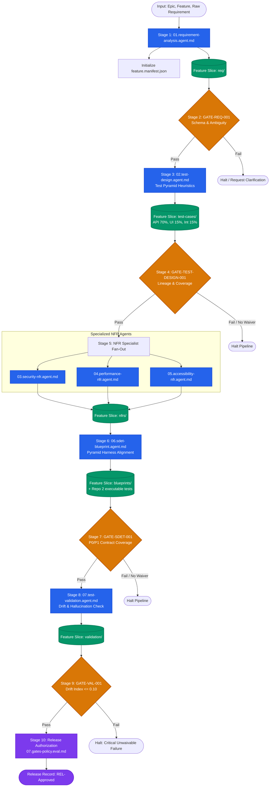

# Agentic Quality Engineering Orchestrator Workflow (`ORCHESTRATOR-WORKFLOW-001`)

This document defines the **end-to-end orchestration pipeline** for the Agentic Quality Engineering Framework. It functions as both the architectural master specification and the **executable instruction guide** for an AI Assistant or automated runtime to execute agents and quality gates in sequence adopting a **Feature-Centric** organization.

---

## 1. High-Level Workflow Architecture



---

## 2. The 7-Step Agent Lifecycle & Feature State Manifest

Every agent in this pipeline adheres strictly to the standardized 7-step lifecycle:

```text
Agent
  │
  ├── 1. Receives Context       (Loaded from feature.manifest.json & upstream stage inputs)
  ├── 2. Consumes Artifact IDs   (Explicit foreign key dependency on parent IDs)
  ├── 3. Performs Reasoning      (Role-based LLM reasoning guided by system prompt)
  ├── 4. Generates Artifact IDs  (Emits versioned child artifacts in feature slice)
  ├── 5. Invokes EVAL            (Executes deterministic or semantic evaluators)
  ├── 6. Passes Quality Gate     (Enforces critical/major thresholds or human waiver)
  └── 7. Publishes Event         (Updates feature.manifest.json & broadcasts Telemetry Event)
```

### Feature Progress Card (`feature.manifest.json`)
At any point in time, the team and subsequent agents can inspect `generated-artifacts/features/{FEATURE_SLUG}/feature.manifest.json` to immediately know the feature's status:

```json
{
  "featureId": "FEAT-INVENTREE-001",
  "featureName": "Part & Part Category Lifecycle Management",
  "featureSlug": "inventree-part-management",
  "epicId": "EPIC-INVENTREE-CORE",
  "overallStatus": "IN_PROGRESS",
  "currentStage": "02.test-design",
  "stages": {
    "01.requirement-analysis": { "status": "COMPLETED", "gate": "GATE-REQ-001", "gateScore": 0.97 },
    "02.test-design":          { "status": "PENDING",   "gate": "GATE-TEST-DESIGN-001" },
    "03.nfr-workforce":        { "status": "NOT_STARTED" },
    "04.sdet-blueprint":       { "status": "NOT_STARTED" },
    "05.test-validation":      { "status": "NOT_STARTED" },
    "06.release-gate":         { "status": "NOT_STARTED" }
  },
  "nextAction": {
    "agent": "agents/02.test-design.agent.md",
    "inputsRequired": ["REQ-INVENTREE-PART-001", "AC-INVENTREE-101", "AC-INVENTREE-102"]
  }
}
```

---

## 3. Step-by-Step Sequential Execution Protocol

When an **AI Assistant** or **Agentic Orchestrator** executes this workflow, execute the stages in the strict sequence below:

### Stage 1: Requirement Analysis
- **Spec:** [`agents/01.requirement-analysis.agent.md`](agents/01.requirement-analysis.agent.md)
- **Inputs:** `rawText`, `epicId`, `featureName`, `domain`, `priority`.
- **Action:**
  1. Initialize `{FEATURE_DIR}/feature.manifest.json`.
  2. Parse raw requirement text and extract Given-When-Then Acceptance Criteria (ACs).
  3. Flag ambiguity, business domain risks, and assess testability (`isTestable == true`).
- **Outputs Produced:**
  - `RequirementArtifact` (`REQ-XXXX`)
  - `AcceptanceCriteriaArtifact[]` (`AC-XXXX`)
- **Persistence Target:** `{REQ_ARTIFACTS_DIR}` (`./generated-artifacts/features/{FEATURE_SLUG}/req/`)

### Stage 2: Requirement Quality Gate (`GATE-REQ-001`)
- **Evaluators:**
  - Deterministic: [`evals/01.schema-validator.eval.md`](evals/01.schema-validator.eval.md) (100% schema match)
  - Semantic: [`evals/04.ambiguity-evaluator.eval.md`](evals/04.ambiguity-evaluator.eval.md)
- **Pass Threshold:** Ambiguity Score $\le 0.15$; $100\%$ of ACs marked `isTestable == true`.
- **Enforcement Level:** `MAJOR`. If score $> 0.15$, halt or request human clarification/waiver.

---

### Stage 3: Test Design (Test Pyramid Driven)
- **Spec:** [`agents/02.test-design.agent.md`](agents/02.test-design.agent.md)
- **Inputs Consumed:** `REQ-XXXX`, `AC-XXXX`.
- **Test Pyramid Directives:**
  - **Core Bulk (~60-70%):** API / Service tests (`targetLayer: "API"`, `classification: "POSITIVE" | "NEGATIVE" | "BOUNDARY"`). Verify all input validation, business logic, headers, and status codes here.
  - **Data / Integration (~15-20%):** Database state verification and messaging integration (`targetLayer: "DATABASE" | "MESSAGING"`).
  - **Apex (~10-15%):** UI / E2E user journeys (`targetLayer: "UI"`, `classification: "E2E"`). Strictly reserved for complete user journeys.
  - **Anti-Ice-Cream-Cone Heuristic:** *Never test via UI what can be validated at the API layer.*
- **Outputs Produced:**
  - `ScenarioArtifact[]` (`SCN-XXXX`)
  - `TestCaseArtifact[]` (`TC-XXXX`)
- **Persistence Target:** `{TC_ARTIFACTS_DIR}` (`./generated-artifacts/features/{FEATURE_SLUG}/test-cases/`)

### Stage 4: Test Design Quality Gate (`GATE-TEST-DESIGN-001`)
- **Evaluators:**
  - Deterministic: [`evals/02.referential-validator.eval.md`](evals/02.referential-validator.eval.md) (Foreign keys valid)
  - Deterministic: [`evals/03.coverage-calculator.eval.md`](evals/03.coverage-calculator.eval.md) (AC-to-Scenario coverage $\ge 0.85$)
  - Semantic: [`evals/05.completeness-evaluator.eval.md`](evals/05.completeness-evaluator.eval.md) (Edge case completeness $\ge 0.85$)
- **Enforcement Level:** `MAJOR`.

---

### Stage 5: Specialized NFR Workforce Fan-Out
Execute the following NFR specialist agents across the requirement:
1. **Security NFR Agent:** [`agents/03.security-nfr.agent.md`](agents/03.security-nfr.agent.md)
   - Generates security abuse test cases (AuthN/AuthZ bypass, OWASP Top 10, IDOR, input sanitization).
2. **Performance NFR Agent:** [`agents/04.performance-nfr.agent.md`](agents/04.performance-nfr.agent.md)
   - Generates load, stress, and p95/p99 latency threshold test cases.
3. **Accessibility NFR Agent:** [`agents/05.accessibility-nfr.agent.md`](agents/05.accessibility-nfr.agent.md)
   - Generates WCAG 2.1 Level AA criteria test cases (keyboard navigation, focus states, screen reader semantics).
- **Persistence Target:** `{NFRS_DIR}` (`./generated-artifacts/features/{FEATURE_SLUG}/nfrs/`)

---

### Stage 6: SDET Automation Blueprint
- **Spec:** [`agents/06.sdet-blueprint.agent.md`](agents/06.sdet-blueprint.agent.md)
- **Inputs Consumed:** All approved functional and NFR `TestCaseArtifact` IDs.
- **Action:**
  - Map each test case to the appropriate harness aligned with the **Test Pyramid**:
    - `REST_API`: For API layer test cases (fast, headless, deterministic).
    - `PLAYWRIGHT_TS`: For UI user journeys and E2E browser flows.
    - `K6_PERF`: For performance and load test cases.
    - `AXE_A11Y`: For automated accessibility audit sweeps.
    - `MANUAL`: For physical or non-automatable workflows.
  - Synthesize tool-agnostic code blueprints and deterministic assertions.
- **Outputs Produced:** `AutomationBlueprintArtifact[]` (`AUT-XXXX`).
- **Persistence Target:** `{BLUEPRINTS_DIR}` (`./generated-artifacts/features/{FEATURE_SLUG}/blueprints/`) & `{AUTOMATION_TESTS_DIR}` (`../agentic-test-automation/tests/`)
    - api tests goes to ``../agentic-test-automation/tests/api`
    - ui tests goes to `../agentic-test-automation/tests/ui`
    
### Stage 7: SDET Quality Gate (`GATE-SDET-001`)
- **Evaluator:** [`evals/03.coverage-calculator.eval.md`](evals/03.coverage-calculator.eval.md)
- **Pass Threshold:** 100% of P0 and P1 test cases must have automation feasibility verified and blueprints generated.
- **Enforcement Level:** `MAJOR`.

---

### Stage 8: Test Validation & Drift Detection
- **Spec:** [`agents/07.test-validation.agent.md`](agents/07.test-validation.agent.md)
- **Inputs Consumed:** Downstream artifacts compared against upstream `REQ-XXXX`.
- **Action:**
  - Cross-examine test cases and blueprints against original requirement intent.
  - Detect hallucinations, ungrounded test assertions, and specification drift.
- **Outputs Produced:** `ValidationReportArtifact` (verdict, driftIndex, hallucinationIndex).
- **Persistence Target:** `{VALIDATION_DIR}` (`./generated-artifacts/features/{FEATURE_SLUG}/validation/`)

### Stage 9: Validation Quality Gate (`GATE-VAL-001`)
- **Evaluator:** [`evals/06.drift-evaluator.eval.md`](evals/06.drift-evaluator.eval.md)
- **Pass Threshold:** Hallucination / Drift Index $\le 0.10$. Zero ungrounded assertions on critical paths.
- **Enforcement Level:** `CRITICAL` (Zero bypass, no human waivers permitted).

---

### Stage 10: Release Quality Gate Authorization (`GATE-RELEASE-001`)
- **Policy Spec:** [`evals/07.gates-policy.eval.md`](evals/07.gates-policy.eval.md)
- **Action:**
  - Compile audit trail of all upstream gate verdicts.
  - Update `feature.manifest.json` with final gate verdict and release authorization.
  - If all Critical and Major gates passed (or Major gates have valid signed waivers):
    - Emit `ReleaseGateRecord` (`REL-XXXX`) with status `PASSED`.
  - If any gate failed:
    - Emit `ReleaseGateRecord` with status `BLOCKED` and list blocking reasons.

---

## 4. Centralized Workspace Directory Mapping (Feature-Centric)

Artifacts are organized into **Feature-Centric vertical slices** with top-level global aggregators:

```text
c:\Users\uhanu\Workspace Github\
├── agentic-orchestration/                      # Repo 1 (Orchestration & Quality Artifacts)
│   ├── agents/                                 # Executable agent specifications (01..07)
│   ├── evals/                                  # Executable evaluator definitions (01..07)
│   ├── agentic-orchestrator.md                 # This orchestration specification
│   ├── run-orchestrator.ts                     # CLI / TypeScript execution driver
│   └── generated-artifacts/                   # Shared Context Store file tree
│       ├── features/                           # Feature-Centric vertical slices
│       │   ├── inventree-part-management/      # Feature Slug directory
│       │   │   ├── feature.manifest.json       # Real-time feature state machine & status
│       │   │   ├── req/                        # REQ and AC markdown + JSON
│       │   │   ├── test-cases/                 # SCN and Functional TC artifacts
│       │   │   ├── nfrs/                       # Security, Perf, and A11y cases
│       │   │   ├── blueprints/                 # SDET Automation Blueprints
│       │   │   └── validation/                 # Drift & validation reports
│       │   └── order-cancellation/
│       │       ├── feature.manifest.json
│       │       └── ...
│       ├── coverage-docs/                      # Global portfolio-level coverage reports
│       └── traceability/                       # System-wide traceability matrices
│
└── agentic-test-automation/                    # Repo 2 (Automation Execution)
    └── tests/                                  # Executable Playwright/API test scripts
        └── features/
            └── inventree-part-management/      # Executable specs matching feature slice
```

---

## 5. Execution Options

### Option A: Direct AI Assistant Execution (Chat / Agent Mode)
1. Provide the AI Assistant with this file (`agentic-orchestrator.md`) and your input requirement.
2. The AI Assistant acts as the Orchestrator, executing each stage in order:
   - Reads the stage agent markdown file.
   - Generates the required JSON and Markdown artifacts in `generated-artifacts/features/{FEATURE_SLUG}/`.
   - Evaluates the gate thresholds.
   - Updates `feature.manifest.json` after each stage.
   - Proceeds to the next stage upon passing each gate.

### Option B: Automated CLI Execution
Run the orchestrator using the TypeScript CLI engine:
```bash
# Run with Mock Provider (offline / unit verification)
npm start

# Run with Google Gemini Live API
npx tsx run-orchestrator.ts --provider=gemini --feature="Part Lifecycle" --story="Your requirement text..."
```
